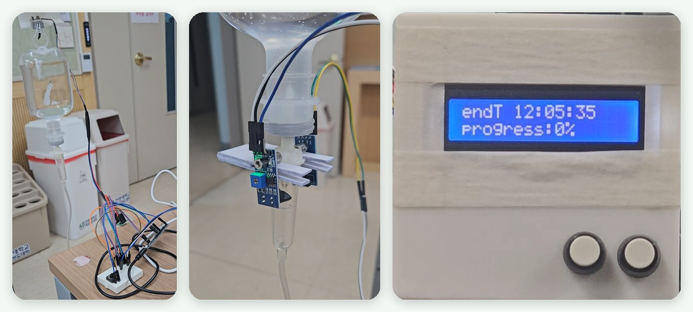
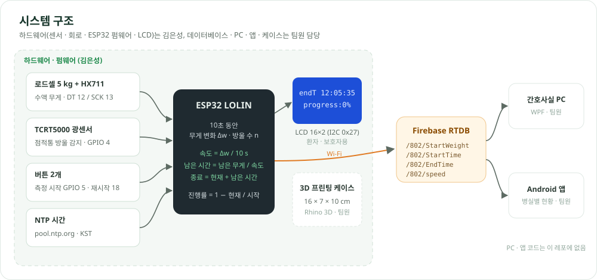
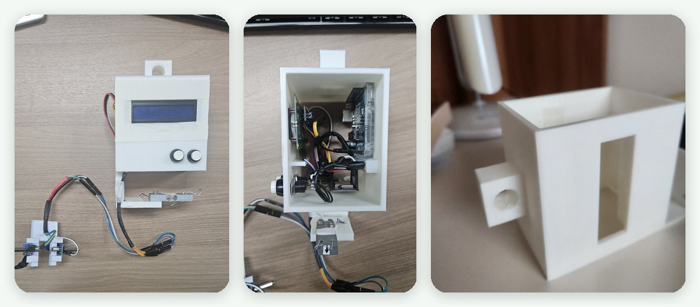
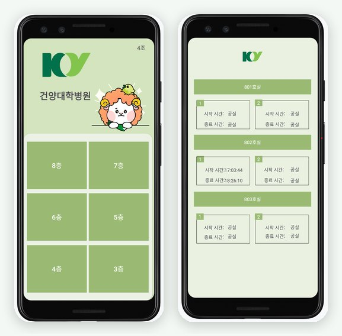

<div align="center">

# 💧 스마트 수액 모니터링

**수액 무게와 떨어지는 방울을 재서, 수액이 언제 끝날지 예측해 보여 주는 ESP32 장치**




</div>

> **EN** · An ESP32 device that clips onto an IV pole: a load cell (HX711) weighs the bag and an IR sensor (TCRT5000) counts drops in the drip chamber. Every 10 s it computes the flow rate, remaining time and estimated end time, shows them on an LCD and pushes them to Firebase so nurses can check each room remotely. I was responsible for the hardware — sensors, wiring, calibration, ESP32 firmware and the LCD — in a 4-person team (2024-2 engineering design course).

간호사 인터뷰에서 "수액 종료 시간을 알려면 병실을 계속 돌며 방울 수를 세어 손으로 계산해야 한다"는 불편을 들었습니다. 이 장치는 수액걸이에 달아 두면 **속도 · 남은 시간 · 종료 예정 시각**을 계산해 침대 옆 LCD와 간호사실 화면에 보여 줍니다.

2024년 2학기 「설계및프로젝트기본」에서 이전 팀의 스마트 링거 거치대를 역설계한 뒤 다시 설계한 4인 팀 프로젝트이고, **센서 · 회로 · 펌웨어 등 하드웨어를 맡았습니다.**

## 맡은 일

| 영역 | 내용 |
|---|---|
| 센서 · 회로 | 로드셀 5 kg + HX711, TCRT5000 광센서, LCD 16×2(I2C), 버튼 2개를 ESP32 LOLIN에 배선 |
| 센서 보정 | 로드셀 보정 계수(309), 수액통 · 거치부 무게 100 g 차감, 광센서 방울 감지 위치 |
| 펌웨어 | 10초 측정 창으로 속도 · 남은 시간 · 종료 시각 계산, NTP 시각 동기화, 이상 측정 재시도, Firebase 업로드 |

팀원은 데이터베이스 연동, 간호사실 PC 프로그램(WPF)과 Android 앱, 3D 프린팅 케이스(Rhino 3D, 16 × 7 × 10 cm)를 맡았습니다. PC · 앱 코드는 이 레포에 없습니다.

## 시스템 구조



## 계산 방법

측정 시작 버튼을 누르면 시작 무게와 시각을 저장하고, 이후 10초 단위로 반복합니다.

```
Δw (g)        = 10초 전 무게 − 10초 후 무게        (수액통 · 거치부 100 g 차감)
속도 (g/s)    = Δw / 10
남은 시간 (s) = 현재 남은 무게 / 속도
종료 시각     = NTP 현재 시각 + 남은 시간
방울당 무게   = Δw / 10초 동안 센 방울 수
진행률 (%)    = 100 − 현재 무게 / 시작 무게 × 100
```

무게가 오히려 늘어난 경우(Δw < 0, 거치대가 흔들렸을 때 등)는 버리고 다시 잽니다.

실제 측정 기록 (시리얼 모니터):

```
10초 전 무게: 378.52
10초 후 무게: 378.04
10초 동안 떨어진 물방울 수: 5
평균 물방울당 무게: 0.10 g
속도: 0.05 g/s
남은 시간: 7946.40 초
종료 시간: 21:41:22
종료 시간 데이터 전송 성공: 21:41:22
```

Firebase에는 병실 번호 아래 `StartWeight`, `StartTime`, `EndTime`, `speed`가 올라갑니다.

## 만든 과정



| 부품 | 연결 (ESP32) |
|---|---|
| 로드셀 5 kg + HX711 | DT → GPIO 12, SCK → GPIO 13 |
| TCRT5000 광센서 (DO) | GPIO 4 |
| LCD 16×2 I2C (PCF8574, 0x27) | SDA 21 · SCL 22 |
| 측정 시작 버튼 / 재시작 버튼 | GPIO 5 / GPIO 18 (내부 풀업) |

## 결과와 한계

- 수액 자동 모니터링이 동작하고, 계산한 종료 시각이 침대 옆 LCD와 Firebase를 거쳐 PC 프로그램 · 앱까지 표시되는 것을 확인했습니다.
- **종료 예측에 5~10분 오차**가 있었습니다. 10초 동안의 무게 변화가 0.1~0.5 g 정도로 작아서 로드셀 잡음의 영향이 큰 것으로 보입니다.
- 광센서 측정 오류가 있었습니다.
- 메인보드가 과부하에 취약하고, 부품 교체가 불편한 케이스 구조였습니다.

개선 방향: 케이스 크기 최적화, 센서 정밀도 높이기(측정 창 늘리기 · 이동평균 등), PC · 앱 종료 임박 알림.

<details>
<summary>팀원이 만든 Android 앱 화면</summary>



</details>

## 펌웨어

```
firmware/
  iv_monitor_final/    최종본 (2024-11-28)
  iv_monitor_v1/       Ver 1.0.0 (2024-11-17)
  drop_sensor_test/    광센서 방울 카운트 + 로드셀 확인
  weight_test/         로드셀 보정
  lcd_test/            LCD · Wi-Fi · Firebase 연결 확인
secrets.example.h      Wi-Fi · Firebase 설정 템플릿
```

1. Arduino IDE 라이브러리: `Firebase ESP32 Client`(mobizt), `HX711`(bogde), `LiquidCrystal_PCF8574`
2. `secrets.example.h`를 쓰려는 스케치 폴더에 `secrets.h`로 복사해 값 입력 (`secrets.h`는 커밋하지 않음)
3. 보드 `ESP32 Dev Module` 또는 LOLIN D32, 시리얼 115200

Wi-Fi · Firebase 정보는 원래 코드에 직접 적혀 있던 것을 `secrets.h`로 옮겼습니다.
